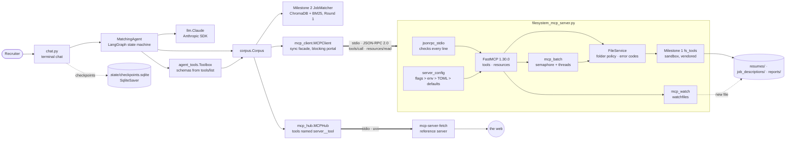
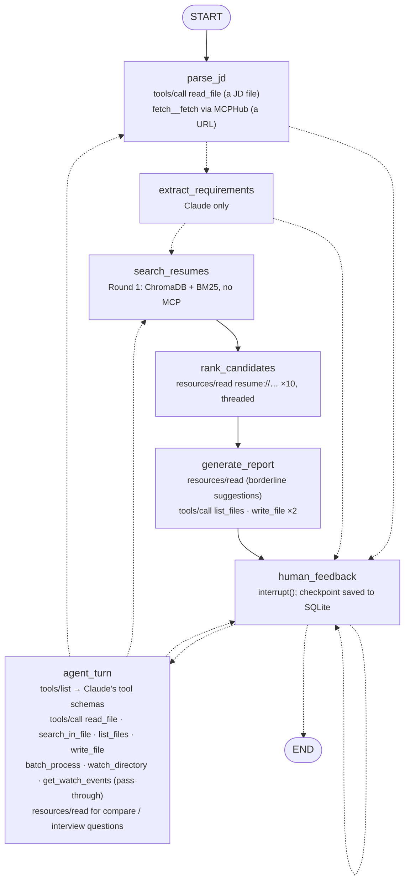

# Agent ↔ MCP architecture

Three views of Milestone 4: which components talk to which, the messages exchanged during a
screening, and where in the LangGraph state machine each MCP call happens. GitHub renders
the Mermaid diagrams. The plain state machine, generated from the compiled graph, is in
[state_machine.md](state_machine.md); the graph itself did not change in Milestone 4.

## 1. Components



`corpus.py` is the only agent module that touches files, and it does so only through
`MCPClient`. No agent module imports `fs_tools` (checked by `tests/test_architecture.py`).
The server child process gets the SDK's minimal environment, so it never sees
`ANTHROPIC_API_KEY`.

## 2. One screening, message by message

```mermaid
sequenceDiagram
    autonumber
    actor R as Recruiter
    participant C as chat.py
    participant G as MatchingAgent (LangGraph)
    participant M as MCPClient
    participant S as filesystem_mcp_server
    participant F as fetch server (bonus)
    participant L as Claude

    C->>M: spawn server (stdio)
    M->>S: initialize (protocolVersion 2025-11-25)
    S-->>M: serverInfo, capabilities {tools, resources}
    M->>S: notifications/initialized
    R->>C: "job_descriptions/backend_engineer.txt" (or a URL)
    C->>G: invoke(jd_input)
    alt a file path
        G->>M: tools/call read_file
        M->>S: JSON-RPC request
        S-->>M: result {content}, isError false
    else a URL, with --mcp-servers
        G->>F: tools/call fetch (via MCPHub)
        F-->>G: the posting as text
    end
    G->>L: extract requirements (structured output)
    G->>G: Round 1: Milestone 2 hybrid search over ChromaDB
    loop Round 2: each of the top 10, in threads
        G->>M: resources/read resume://<file>
        M->>S: JSON-RPC request
        S-->>M: contents [text]
        G->>L: judge the resume against each requirement
    end
    G->>M: tools/call list_files reports (is the name free?)
    G->>M: tools/call write_file reports/<role>-<date>-round-1.md and .json
    S-->>M: success, or isError ALREADY_EXISTS (never overwrites)
    G-->>C: summary; interrupt() at human_feedback
    R->>C: "Use batch_process to count resumes mentioning Kubernetes"
    C->>G: Command(resume=message)
    G->>M: tools/list (cached): schemas for Claude
    G->>L: converse(tools = local + server tools)
    L-->>G: tool_use batch_process {...}
    G->>M: tools/call batch_process (passed through: no agent code for it)
    S--)M: notifications/progress (one per file)
    S-->>M: {total, ok, failed, results}
    G->>L: tool_result
    L-->>G: answer
    G-->>C: reply; interrupt() again
    Note over S: with --watch: watch_directory on resumes/
    S--)M: notifications/resources/list_changed
    S--)M: notifications/message {event: new_file, path}
    C->>G: next message carries "new file(s) arrived: resumes/..."
```

## 3. The state machine, annotated with MCP calls

The same seven nodes and edges as the generated [state_machine.md](state_machine.md), with
the MCP requests each node makes. Nodes without a note make none.



## Error layers

| Layer | What goes wrong | What the client gets |
|---|---|---|
| JSON-RPC (transport) | not JSON, a batch array, `jsonrpc` not `"2.0"`, a null id, an unknown method | an error object: -32700, -32600, -32601 (from `jsonrpc_stdio.py`) |
| MCP request | bad `tools/call` params, an unknown tool name | -32602 |
| Resources | unknown URI or missing file; hidden or disallowed file; unreadable file | -32002; -32602; -32603, each with `data.error_code` |
| Tool execution | anything a tool refuses or fails at | a result with `isError: true` and `{error_code, message, filepath}` |
| HTTP (`--transport streamable-http` only) | no `Accept: application/json, text/event-stream`; an unknown `mcp-session-id` or path; a body that is not JSON | 406; 404; 400 with a -32700 body (the SDK's transport; `tests/test_mcp_http.py`) |
